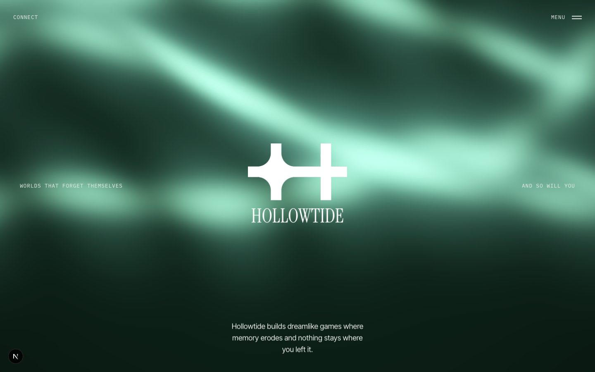
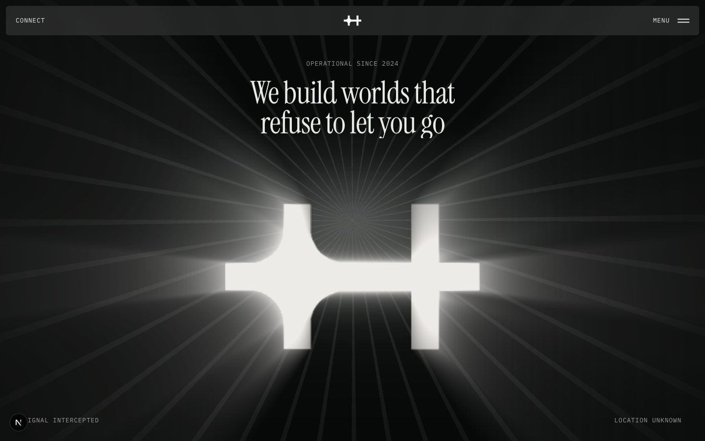
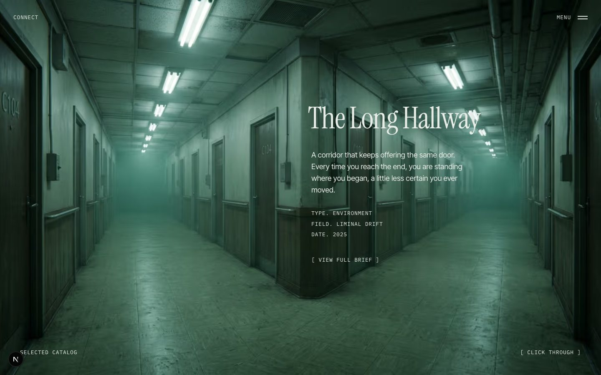
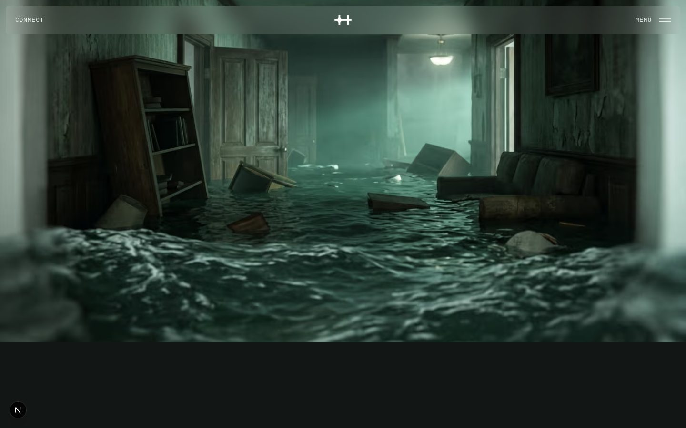
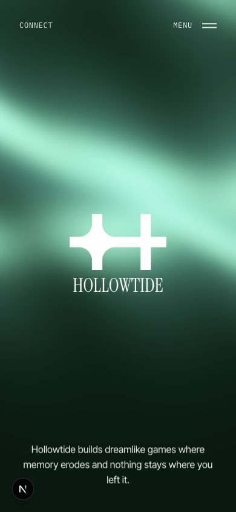

# Hollowtide

The website of Hollowtide, a fictional game studio that makes quiet, dreamlike worlds where memory slips and rooms rearrange themselves when you look away.

I made it to see how far a studio site can lean on mood: dark green light, slow motion, and very little text. The studio, the four "worlds", the logo, the photos and the copy are all mine.



## What's on the site

- **Intro**: a counter stumbles up to 100 while a slate panel grows from the middle of the screen, then the cover lifts away and the hero rises into place.
- **Home**: an aurora that drifts behind the logo. Further down, the page holds still while a light rises behind the mark and throws beams through it. The featured worlds come in through horizontal strips, the team rides across on the rim of a huge wheel, and the footer is a slow cloud of smoke that leans towards your cursor.
- **Catalog**: one world per screen. Click and the picture zooms through to the next one while the text flickers out and back in.
- **Each world**: its own page with the brief, the story and a few stills.
- **Studio**: the stills wound into a 3D helix that spins faster as you scroll, the manifesto writing itself in word by word, and four panels that open under the pointer.
- **Connect**: images that open band by band along your pointer's path and close again.
- **Between pages**: two rows of blocks close over the screen and open on the next page. Labels and menu links flicker into place through random letters.



| Catalog | A world |
| --- | --- |
|  |  |

## Made to work everywhere



- Phones get their own layouts: the panels on Studio stack up, the catalogue text centres, and the team wheel turns on a wider, flatter curve.
- The image trail on Contact works with a finger too, and on touch screens images also surface on their own.
- The WebGL effects pause when they're off screen, run at 30 fps on touch devices, and fall back to a plain gradient when WebGL isn't there.
- With "reduce motion" turned on, everything still shows up. It just doesn't move.
- Smooth scrolling is only enabled for a mouse or trackpad. Touch keeps the phone's native scrolling.
- Photos are served as AVIF/WebP at the right size for the screen.

<br clear="right">

## Built with

Next.js (App Router), React, CSS Modules, GSAP with ScrollTrigger and SplitText, Lenis, and raw WebGL (no 3D library) for the aurora, the light, the helix, the catalogue transition and the smoke. The fonts are Instrument Serif, Inter Tight and IBM Plex Mono, all free under the SIL Open Font License.

## Run it

```bash
npm install
npm run dev
```

Then open http://localhost:3000.

---

Designed and built by [Paolo Meccariello](https://www.paolomeccariello.dev/).
